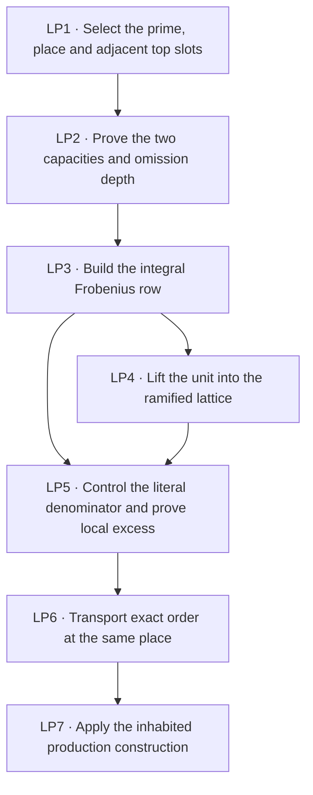

# Type I torsion in Lamport Plus

The deciding fact is that **one integral row detects a unit on the ramified numerator and a multiple of $p^{T+1}$ on every term of the literal first span**. The local quotient then has an extra layer. A separate use of the same served comparison turns that local survival into exact order globally and at the selected place. Start with the [reader guide](EXPLAINED.md) for the idea, or the [paper](../manuscript/paper_github.md) for the full estimates and constructions.

## Exact target

**Theorem A and Proposition B, v0.1.1.** Assume $0<\varepsilon<1/52$ and take the original $F:\mathrm{FamP}(\varepsilon)$ and real constants $C_0,C_H$ with `ChosenE F C₀ CH`, `ChosenWall F`, `TuSize F` and `GroupCompatibilityFamily F`. Use the comparison from `F.ex`. There is a threshold $x_0>F.x_1$. **Take** $x\in F.\mathrm{Win}$ above the threshold, an index $i:F.\mathrm{Ix}(x)$ and a word $u$ of $D=F.D(x,i)$. Only then **choose** $p,w$. The prime satisfies `Cand`, $p_0\le p<X'$ and $p\notin L.\mathrm{drop}$ for $L=F.L(x,i)$. The place $w$ over $p$ is supported and off the word’s level prime, with the native `GIdx` data. The selected rank-one orbit has two distinct adjacent top slots. Both results use this choice.

Write $T=(\lceil\tau_P\rceil).\mathrm{toNat}$ and $R=T+1$ for this member and prime. The global quotient $C_u$ divides $A_u=\mathrm{DV.MramL}(D,u)$ by the comap of $N_u=L.\mathrm{NuLat}(u)$. Write $A_w=M_w\cap V_{\mathrm{ram},w}$ and let $U_w$ be the comap of $\mathrm{NP}_w$ to $A_w$. The theorem identifies $U_w=P_w\cap p^TA_w$ inside $A_w$, where $P_w$ is the first span in the definition of $\mathrm{NP}_w$. It gives a surjection

$$
p^TA_w/U_w \twoheadrightarrow p^TO_w/p^{T+1}O_w,
$$

and one $z\in C_u$ of exact additive order $p^{T+1}$ whose image under the actual comparison has the same order at $w$. It also gives $p^TA_w\nsubseteq P_w$ and finite local length at least $e_w T\operatorname{rank}_{O_w}(A_w)+e_w$, with $e_w=v_{O_w}(p)>0$.

**Production corollary.** Under the established design and host construction the proof obtains, for every real lower bound, an inhabited member, a word and the above witnesses. The witnesses are existential. [Original statement](../manuscript/paper_github.md#main-result) · [Production argument](../manuscript/paper_github.md#selection)

## Dependency map

Each arrow gives a proof dependency. Every branch after selection uses the same $x,i,u,p,w$.

The route in words is selection and depth, then the row and seed, then the local quotient and exact order, then production. Expand any step below for its hypotheses and justification.

## LP1. Select the fibre for the fixed word

Given, show and proof

**Given** the original family hypotheses and the fixed member and word. **Show** that one eligible prime has an occupied selected orbit with adjacent top slots, and gives a supported served place for this word.

- **⟨2⟩1. Count pairs before choosing a prime.** Put $Z=(X')^{3/4}$. The tent weight on $(Z,2Z)$ has positive principal mass. The scaled contour bound controls each nonprincipal character, including the exceptional real term. Orthogonality then supplies weight in the individual host Artin classes. If $S$ is the set of top positions, the ordered-pair counts $C(h)=|\{t\in S:t+h\in S\}|$ satisfy $\sum_h C(h)=|S|^2$. The family bounds $n\ge x^2$ and $|S|\ge nx^{-\varepsilon/8}/2$ make the $O_F(x^{\varepsilon/2})$ short-order steps $o_F(|S|)$. Each can remove at most $|S|$ pairs, so more than half the pairs survive for sufficiently large $x$.
- **⟨2⟩2. Impose the source exclusions.** Use the inert Artin class to identify the actual step $h_p$. The wall, share and bad-top bounds and the level exclusions remove less weight than the remaining lower bound. The original selector gives `Cand`, excludes `drop` and provides the pair in the same selected orbit. The supported-place construction uses the already fixed word. The source slot ties identify the top positions with consecutive native slots, including a possible cyclic wrap.
- **⟨2⟩3. Read the cutoffs.** The selector gives $p_0\le p$ and $Z<p<2Z$. The returned `Cand` includes $p<X'$. The window-scale estimate enters the construction of `Cand`.

**Dependents.** LP2, LP3 and LP7. [Paper §4](../manuscript/paper_github.md#selection) · [Lean selector](../lean/src/Formalism/SharpRestriction/GrowthBounds/TypeIPrimeSelection.lean#L1463) · [Definition of `Cand`](https://github.com/leanprover-community/riemann-hypothesis/blob/9282d3a102c4aff0e6026746db2a8990f5d9cddd/src/Formalism/SharpRestriction/GrowthBounds/IsResidueClassZero.lean#L309-L311)

## LP2. Check both capacities and the omission depth

Given, show and proof

**Given** the LP1 pair $s,s^+$ on the selected orbit and $R=T+1$. **Show** $pR\le m_s$, $R\le m_{s^+}$, and $R\le\lceil\mathrm{Sv}(v)\rceil.\mathrm{toNat}$ for the original cutoff and orbit data.

- **⟨2⟩1. Bound the demand.** Sum the source cutoff using the bound on the total top positions. On this prime window the family band bound controls the logarithmic term in the cutoff, and the other terms are small relative to $a/p$, with $a=x\exp(x^\varepsilon)$. The paper obtains $R\le a/(4p)$ eventually.
- **⟨2⟩2. Supply the factors.** At a top position the relevant signed multiplicity has lower bound $a-c_G\ge a/2$ on the same tail. This supplies the $pR$ factors at $s$ and $R$ at $s^+$.
- **⟨2⟩3. Supply the skipped-orbit power.** The adjacent top pair excludes the first odd visit at one lift. The gain comparison leaves the positive contribution of that visit, after subtracting the displacement and penalty. This exceeds $R$ eventually. The other lifts enter the omission weight through nonnegative terms.

**Dependents.** LP3 uses the two capacities. LP5 uses the omission depth. [Paper `4](../manuscript/paper_github.md#selection) · [Lean depth proof](../lean/src/Formalism/SharpRestriction/GrowthBounds/TypeIFiniteDepth.lean#L1450) · [Native capacity](../lean/src/Formalism/SharpRestriction/GrowthBounds/TypeIFiniteDepth.lean#L1491)

## LP3. Build the integral Frobenius row

Given, show and proof

**Given** the native rank-one edge model, the ordered Weyl generators and the two capacities. **Show** that one integral row reads a unit on a chosen native output and takes normalized incoming contributions into $p^RO_w$.

- **⟨2⟩1. Preserve the actual coefficients.** Label each factor in the products of minors. Cauchy–Binet, ordered substitution and divided coefficient extraction represent the native Weyl generators, including the determinant twist. Each lifted coefficient is integral.
- **⟨2⟩2. Force divisibility on every incoming term.** After normalization the frames satisfy $V_j^{\mathsf T}U_j=p(\det g_j)^{-1}I$. Frobenius relates the constant matrices of adjacent slots modulo rational $p$. Applying Frobenius to the orthogonality identity gives the cross-slot vanishing for independent slot variables. Within each group the $p$ factors at the first slot use the same generic flag, so their product gives the coordinatewise Frobenius power. Use $R$ disjoint groups and apply the divisibility before coefficient extraction. The integral functional applies to each term with its native coefficient and character transport. [Checked contractions](../lean/src/Formalism/SharpRestriction/GrowthBounds/TypeIAdjacentContractions.lean#L36-L66)
- **⟨2⟩3. Exhibit one unit on the output.** Use the empty word in every slot. At the standard output a constant determinant-one shear $I-E_{1k}$ in the line slot preserves the lattice and gives $e_1+e_k$ in the inverse-transpose coordinates. The unchanged hyperplane gives $e_k^*$. The marked pairing reads $1$ in either orientation, and every unused leading minor is $1$. [Checked shear](../lean/src/Formalism/SharpRestriction/GrowthBounds/TypeINativeShearUnit.lean#L12-L26)

**Dependents.** LP4 uses the unit at the output. LP5 uses incoming divisibility. [Paper `2](../manuscript/paper_github.md#separation) · [Lean native row](../lean/src/Formalism/SharpRestriction/GrowthBounds/TypeINativeSeparatingRow.lean#L14)

## LP4. Lift the unit into the ramified lattice

Given, show and proof

**Given** LP3’s row and the chart on the same class, tuple and word, with the original group comparison. **Show** that there is $b\in A_u$ whose actual compared value $a_w=c_w(b)\in A_w$ still reads as a unit.

- **⟨2⟩1. Use integral masking and chart evaluation.** The comparison identifies the chart evaluation with restriction on the original word forms. Mask to that adelic class using preservation of the actual integral lattice. Support as a property of a function would not by itself prove this preservation.
- **⟨2⟩2. Preserve the restriction.** Apply the product of integral differences $1-D_j$, with $D_j$ the sign diamond in tame coordinate $j$. Every nonempty subset has a nontrivial sign multiplier and moves the class by upstream freeness. The support formula uses the inverse translate and makes that term vanish at the chosen class. The empty term preserves the whole restriction.
- **⟨2⟩3. Kill the full tame norms.** Multiplication by the sign reindexes the entire residue-unit sum, so $N_j(1-D_j)=0$. Move the other factors past $N_j$ by cross-coordinate commutation. The result is ramified and integral, and its chart evaluation agrees with that of the original integral input.
- **⟨2⟩4. Extract a unit from the span.** The native delta makes evaluation of the local integral model onto the Weyl lattice at this chart. The compared global integral lattice spans the local model, so the chart evaluations of actual global ramified forms span the Weyl lattice too. If the row took every one of these evaluations into the maximal ideal, it would take the whole Weyl lattice there, contradicting LP3. An actual ramified numerator thus has unit readout.

**Dependent.** LP5. [Paper `2](../manuscript/paper_github.md#separation) · [Supported lift](../lean/src/Formalism/LocalToGlobal/GlobalTheory/GL6/DiagonalSlopes/SupportedSeed.lean#L135) · [Native assembly through the seed bridge](../lean/src/Formalism/LocalToGlobal/GlobalTheory/GL6/DiagonalSlopes/TypeINativeQuotient.lean#L17)

## LP5. Control the denominator and expose the first excess

Given, show and proof

**Given** LP2’s omission depth, LP3’s row $\lambda$, and LP4’s unit numerator. **Show** the first-layer surjection, noncontainment, finite local length bound and survival of $p^Ta_w$.

- **⟨2⟩1. Test the entire first span.** A retained-orbit term contains the selected operator $Y_v$. Commutation and integral preservation put its value in $Y_vM_w$, to which LP3 applies. An omitted-orbit term carries a scalar multiple of $p^R$ by LP2. Hence $\lambda(P_w)\subseteq p^{T+1}O_w$.
- **⟨2⟩2. Use the literal comap.** The original $\mathrm{NP}_w$ is the intersection of $P_w$, $p^TM_w$ and $V_{\mathrm{ram},w}$. Since the ramified subspace is linear over the fraction field, $p^TM_w\cap V_{\mathrm{ram},w}=p^TA_w$. Thus $U_w=P_w\cap p^TA_w$ inside $A_w$. The row descends on $p^TA_w/U_w$. It sends $p^Ta_w$ to $p^T$ times a unit, so its value generates $p^TO_w/p^{T+1}O_w$. In particular $p^Ta_w\notin P_w$.
- **⟨2⟩3. Count the lengths.** The scalar quotient $A_w/p^TA_w$ has length $e_wT\operatorname{rank}_{O_w}(A_w)$ by freeness over the DVR. Its kernel under the quotient projection from $A_w/U_w$ is $p^TA_w/U_w$, whose scalar target has length $e_w$. The empty-subset term supplies a sufficiently large common killing power and gives finite length.

**Dependent.** LP6 uses the surviving numerator and the eventual killing power. [Paper `3](../manuscript/paper_github.md#same-place-order) · [Literal span](../lean/src/Formalism/SharpRestriction/GrowthBounds/TypeILiteralNP.lean#L151) · [First layer](../lean/src/Formalism/SharpRestriction/GrowthBounds/TypeILocalExcess.lean#L115) · [Length](../lean/src/Formalism/SharpRestriction/GrowthBounds/TypeILocalLength.lean#L128)

## LP6. Obtain one exact order in both quotients

Given, show and proof

**Given** the original served comparison and LP5’s seed survival and killing power. **Show** one class $z\in C_u$ of exact order $p^R$ with local image also of exact order $p^R$.

- **⟨2⟩1. Descend the actual map.** For a numerator the native served equivalence identifies zero in the local quotient with membership in the word denominator after some integral multiplier outside the prime of $w$. The served equivalence applies because LP1 supplies a selected orbit. A numerator already in $N_u$ uses multiplier $1$, so the comparison descends through the global comap. The formula on representatives uses the same local numerator map.
- **⟨2⟩2. Locate the first crossing.** Let $P(k)$ mean that some multiplier outside that prime sends $p^{T+k}b$ into $N_u$. By LP5 and the served equivalence, $P(0)$ is false and $P(k)$ holds for a sufficiently large $k$. Choose consecutive indices $k,k+1$ with $P(k)$ false and $P(k+1)$ true, and let $c$ be a multiplier for $P(k+1)$. Set $z=[c p^k b]$. Then $p^{T+1}z=0$ globally.
- **⟨2⟩3. Preserve the preceding power.** If the image of $p^Tz$ were zero, the same served equivalence would supply another multiplier $d$ outside the prime. The product $dc$ is outside it by primality, and would witness $P(k)$, contradicting the choice. Thus $p^Tz$ survives locally and hence globally. A divisor of $p^{T+1}$ that does not divide $p^T$ is exactly $p^{T+1}$. The inclusion of $A_w/U_w$ into the ambient served quotient $M_w/\mathrm{NP}_w$ preserves the local order.

**Dependent.** LP7. [Paper `§1 and 3](../manuscript/paper_github.md#same-place-order) · [Comparison on representatives](../lean/src/Formalism/LocalToGlobal/GlobalTheory/GL6/DiagonalSlopes/TypeISamePlaceOrder.lean#L48) · [First crossing and exact order](../lean/src/Formalism/LocalToGlobal/GlobalTheory/GL6/DiagonalSlopes/TypeISamePlaceOrder.lean#L72)

## LP7. Apply the inhabited production construction

Given, show and proof

**Given** the original design supplier and matching host construction. **Show** a genuine witness beyond any real lower bound $y$.

- **⟨2⟩1. Apply the indexed theorem.** The original supplier and its duty and selected-group data give the family and the four named hypotheses, with `ChosenE F 3 CH`. The indexed theorem takes the member and word as inputs and supplies the arithmetic selection and the row internally.
- **⟨2⟩2. Produce the member and word.** Apply `FamCore.exists_pt` at $\max(y,x_0)$ and choose the member it supplies. Take the source word $u_0$ and apply the indexed theorem there. The distinguished production declaration also constructs the upstream hypothesis bundle and host. The lower bound $y$ is its only explicit input.

**QED.** The existential production witnesses come from this caller and the same-place class is the one constructed in LP6. [Paper `4](../manuscript/paper_github.md#selection) · [Indexed result](../lean/src/Formalism/LocalToGlobal/GlobalTheory/GL6/DiagonalSlopes/TypeIIndexedTargets.lean#L122) · [Inhabited caller](../lean/src/Formalism/LocalToGlobal/GlobalTheory/GL6/DiagonalSlopes/TypeIProductionCaller.lean#L111)

## How to read the evidence

The step links map the paper argument to its Lean counterpart. The returned `Cand` gives $p<X'$ in LP1, and the injection in LP6 transfers the checked local order to the ambient quotient. The native build and transitive axiom audit passed for the integrated result. The six passing fixed-place replays use a different export and take the chart-unit interface as input. The integrated replays and reference comparison were paused before execution. The model calculation and questions in the reader guide illustrate the proof. [Lean correspondence and exact endpoints](../verification/LEAN.md) · [Completed Modal work](../verification/MODAL.md)

## Reader reconstruction

A separate Codex reader used only the earlier reader guide and proof map. It recovered the proof from prime selection through the inhabited caller and answered four reconstruction questions. It identified that the guide should name the prime of the same place in the multiplier condition. The guide now includes a reconstruction and transfer task for the learning pilot. Independent human reader assessment is pending. [Pilot instructions and questions](EXPLAINED.md#reconstruct-the-proof)
