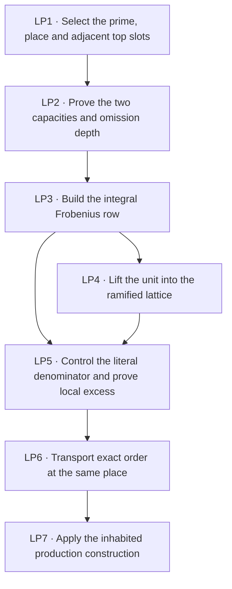

# Type I torsion in Lamport Plus

The deciding fact is that **one integral row detects a unit on the ramified numerator and a multiple of $p^{T+1}$ on every term of the literal first span**. The local quotient then has an extra layer. A separate use of the same served comparison turns that local survival into exact order globally and at the selected place. Start with the [reader guide](EXPLAINED.md) for the idea, or the [paper](../manuscript/paper_github.md) for the full estimates and constructions.

## Exact target

**Theorem A and Proposition B, v0.1.1.** Assume $0<\varepsilon<1/52$ and take the original $F:\mathrm{FamP}(\varepsilon)$ and real constants $C_0,C_H$ with `ChosenE F C₀ CH`, `ChosenWall F`, `TuSize F` and `GroupCompatibilityFamily F`. Use the comparison from `F.ex`. There is a threshold $x_0>F.x_1$. **Take** $x\in F.\mathrm{Win}$ above the threshold, an index $i:F.\mathrm{Ix}(x)$ and a word $u$ of $D=F.D(x,i)$. Only then **choose** $p,w$. The prime satisfies `Cand`, $p_0\le p<X'$ and $p\notin L.\mathrm{drop}$ for $L=F.L(x,i)$. The place $w$ over $p$ is supported and off the word’s level prime, with the native `GIdx` data. The selected rank-one orbit has two distinct adjacent top slots. Both results use this choice.

Write $T=(\lceil\tau_P\rceil).\mathrm{toNat}$ and $R=T+1$ for this member and prime. The global quotient $C_u$ divides $A_u=\mathrm{DV.MramL}(D,u)$ by the comap of $N_u=L.\mathrm{NuLat}(u)$. Write $A_w=M_w\cap V_{\mathrm{ram},w}$ and let $U_w$ be the comap of $\mathrm{NP}_w$ to $A_w$. The theorem identifies $U_w=P_w\cap p^TA_w$ inside $A_w$, where $P_w$ is the first span in the definition of $\mathrm{NP}_w$. It gives a surjection

$$
p^TA_w/U_w \twoheadrightarrow p^TO_w/p^{T+1}O_w,
$$

and one $z\in C_u$ of exact additive order $p^{T+1}$ whose image under the actual comparison has the same order at $w$. It also gives $p^TA_w\nsubseteq P_w$ and finite local length at least $e_w T\operatorname{rank}_{O_w}(A_w)+e_w$, with $e_w=v_{O_w}(p)>0$.

**Production corollary.** Under the established design and host construction the proof obtains, for every real lower bound, an inhabited member, a word and the above witnesses. The witnesses are existential. [Original statement](../manuscript/paper_github.md#main-result) · [Production argument](../manuscript/paper_github.md#selection)

## Dependency map

Each arrow gives a proof dependency. Every branch after selection uses the same $x,i,u,p,w$.

1. **LP1.** Fix the word first. Use the weight that remains after the arithmetic exclusions to choose one prime, place and pair of adjacent slots.
2. **LP2.** Compare the cutoff with the number of available factors and with the power supplied by omitting the selected orbit.
3. **LP3.** Build one row from the labelled contractions. It reads a unit at the standard output and a multiple of $p^{T+1}$ on the incoming terms.
4. **LP4.** Use the chart and the span of actual global ramified numerators to get a unit on a numerator of the fixed word.
5. **LP5.** Test both branches of the literal denominator. The resulting scalar-layer surjection detects extra length and survival.
6. **LP6.** Clear the first power that kills locally with a multiplier outside the same prime. The preceding power proves exact order for one class in both quotients.
7. **LP7.** Construct a family and use its inhabited window to supply a member and word to the indexed result.

Expand a block for its hypotheses and child steps. The [claim register](CLAIMS.csv) records dependencies and the [discovery companion](DISCOVERY.md) gives the backward argument and counterexamples.

## LP1. Select the fibre for the fixed word

Given, show and proof

**Given** the original family hypotheses and the fixed member and word. **Show** that one eligible prime has an occupied selected orbit with adjacent top slots, and gives a supported served place for this word.

### LP1.1. Bound the character sums

**⟨3⟩1.** Put $Z=(X')^{3/4}$ and apply the normalized second difference at $Z,3Z/2,2Z$. Applied to the raw weight $(y/j-1)_+$ for a summation index $j$, it gives the tent weight $w_p=\log(p)\max(0,\min(p-Z,2Z-p))/(Zp)$ on primes. Linear centerings cancel. The principal contribution of $y\log y$ is $c_0=\log(32/27)>0$. [Stencil and principal mass](../lean/src/Formalism/SharpRestriction/GrowthBounds/TypeIPrimeSelection.lean#L599-L693)

**⟨3⟩2.** For a nonprincipal character the contour height is $x^{14}$. The source conductor and node bounds give normalized ordinary error $O_F(x^{-13})$. If the contour has an exceptional zero $\beta\in[1/2,1)$, write $d_\beta=\beta(1-\beta)$ and $E_\beta(y)=y^{\beta-1}/d_\beta$. The thin estimate at $X'$ gives $E_\beta(X')\le\eta=O_F(x^{-13})$. Eventually $\eta\le e^{-1}$, so $(1-\beta)\log X'\ge 1$ and $d_\beta^{-1}\le 2\log X'$. For $y\ge Z$, $E_\beta(y)\le 2\log X'\,\eta^{3/4}=O_F(x^{-39/4+\varepsilon/3})$. When the exceptional set is empty the exceptional term is zero. [Exceptional transfer and uniform estimate](../lean/src/Formalism/SharpRestriction/GrowthBounds/TypeIPrimeSelection.lean#L499-L593)

**⟨3⟩3.** Apply these bounds at the three stencil nodes. Removing proper prime powers and ramified primes costs $O_F(Z^{-1/2}\log^2(2Z)+Z^{-1}\log(2M))$, with $M$ the conductor bound in the paper. The principal prime mass is eventually at least $3c_0/4$. Each nonprincipal prime sum is $O_F(x^{-9})$ uniformly over the host characters. [Principal prime weight](../lean/src/Formalism/SharpRestriction/GrowthBounds/TypeIPrimeSelection.lean#L917) · [Nonprincipal prime weight](../lean/src/Formalism/SharpRestriction/GrowthBounds/TypeIPrimeSelection.lean#L956)

### LP1.2. Lower-bound each Frobenius-class weight

Set $n=|D.R.A|$. Orthogonality writes the weight of a single class as the sum over host characters divided by $4n$. The aggregate nonprincipal error before division is $O_F(nx^{-9})$, since there are $4n$ characters and $n\le x^3$. It is eventually at most $c_0/4$. LP1.1 therefore gives at least $c_0/(8n)$ in each class, including the classes realizing an inert step. [Host class weight](../lean/src/Formalism/SharpRestriction/GrowthBounds/TypeIPrimeSelection.lean#L1005)

### LP1.3. Count long-order adjacent pairs

**⟨3⟩1.** Let $S$ be the top positions and $m=|S|$. Each ordered pair contributes once to $C(h)=|\{t\in S:t+h\in S\}|$, so $\sum_h C(h)=m^2$ and $C(h)\le m$. A cyclic subgroup of bounded index gives $O_F(x^{\varepsilon/2})$ steps of order less than $x^{\varepsilon/4}$ by summing the number of solutions of $rh=0$ over the short orders $r$. With $n\ge x^2$ and $m\ge nx^{-\varepsilon/8}/2$, the discarded count is $o_F(m^2)$. At least $m^2/2$ pairs remain eventually. [Short orders](../lean/src/Formalism/SharpRestriction/GrowthBounds/TypeIPrimeSelection.lean#L1089-L1229)

**⟨3⟩2.** Use the inert Artin class for each remaining $h$ to realize the source step $h_p=h$. If $\mathcal P$ is the resulting long-order inert prime set in $(Z,2Z)$, LP1.2 gives

$$
\frac{1}{m}\sum_{p\in\mathcal P}w_p C(h_p)
\ \ge\ \frac{c_0 m}{16n}\ \ge\ \frac{c_0}{32}x^{-\varepsilon/8}.
$$

Here $m>0$ follows from the lower bound on $m$. [Weighted pair count](../lean/src/Formalism/SharpRestriction/GrowthBounds/TypeIPrimeSelection.lean#L1237) · [Inert identification](../lean/src/Formalism/SharpRestriction/GrowthBounds/TypeIPrimeSelection.lean#L1123)

### LP1.4. Pay the exclusion budget

**⟨3⟩1.** On the prime window the scale guards give $p_0\le p<X'$ and exclude all positive powers of $p$ from the source band. With primality, inertness and long order this gives `Cand`. For the fixed word put $Q=(D.\mathrm{mem}(u)).A.T$. The level bound $Q>2Z$ makes $p\ne Q$. Divisors of $Q-1$ carry total weight at most $\log Q/(2Z)$, by $w_p\le\log(p)/(2p)$ and the product of those distinct primes dividing $Q-1$. [Window guards](../lean/src/Formalism/SharpRestriction/GrowthBounds/TypeIFiniteDepth.lean#L532) · [Level charge](../lean/src/Formalism/SharpRestriction/GrowthBounds/TypeIPrimeSelection.lean#L1279)

**⟨3⟩2.** If no pair survives, every pair fails the share bound, lies on a bad top, or has $p\mid Q-1$. The wall and bad-top bounds and the level charge then bound the normalized sum by $x^{-9}+x^{-2+\varepsilon}+\log Q/(2Z)$. Eventually each term is at most $(c_0/128)x^{-\varepsilon/8}$. Their sum is strictly below LP1.3. Hence some $p,t$ survive all three exclusions. The good representative of $t$ belongs to the selected-orbit set and also contains $t+h_p$. This selected orbit rules out `noGain`. The source drop criterion gives $p\notin L.\mathrm{drop}$. [Loss inequality](../lean/src/Formalism/SharpRestriction/GrowthBounds/TypeIPrimeSelection.lean#L1362-L1458) · [Contradiction and surviving pair](../lean/src/Formalism/SharpRestriction/GrowthBounds/TypeIPrimeSelection.lean#L1540-L1581)

### LP1.5. Pass to the native place and slots

Apply the supported-place lemma to the chosen $p$ and the original word $u$. The upper cutoff contained in `Cand` enters the support test. The level exclusions and source scale fields supply the native `GIdx` data. The family ties identify $t,t+h_p$ with distinct cyclically adjacent top slots of the rank-one orbit, including at the wrap. Both slots and the selected orbit are data on this same $w$. [Supported-place lemma](../lean/src/Formalism/SharpRestriction/GrowthBounds/TypeIPrimeSelection.lean#L69-L87) · [Native slots](../lean/src/Formalism/SharpRestriction/GrowthBounds/TypeIFiniteDepth.lean#L400-L461)

**Dependents.** LP2, LP3 and LP7. [Paper §4](../manuscript/paper_github.md#selection) · [Lean selector](../lean/src/Formalism/SharpRestriction/GrowthBounds/TypeIPrimeSelection.lean#L1463) · [Definition of `Cand`](https://github.com/leanprover-community/riemann-hypothesis/blob/9282d3a102c4aff0e6026746db2a8990f5d9cddd/src/Formalism/SharpRestriction/GrowthBounds/IsResidueClassZero.lean#L309-L311)

## LP2. Check both capacities and the omission depth

Given, show and proof

**Given** the LP1 pair $s,s^+$ on the selected orbit and $R=T+1$. **Show** $pR\le m_s$, $R\le m_{s^+}$, and $R\le\lceil\mathrm{Sv}(v)\rceil.\mathrm{toNat}$ for the original cutoff and orbit data.

### LP2.1. Bound the complete cutoff

**⟨3⟩1.** Set $a=x\exp(x^\varepsilon)$, $b'=a/X'$, $\mu=D.R.m$ and $d=\operatorname{addOrderOf}(h_p)$. Sum over the selected orbits using the bound $n$ on the total top positions. With $\mathrm{Lead}$ and $\mathrm{Round}$ the source leading and rounding costs, the finite inequality is

$$
R\le X.\mathrm{ep}(p)+1+\mu n\bigl(\mathrm{Lead}+\mathrm{Round}+2dc_G+\mathrm{DIf}+2\bigr).
$$

Here $\mathrm{Lead}=2b'+\kappa_1N_1(a/p^2+\mathcal L a/(pk))$. The definition of $\mathrm{Round}$ retains the terms in $Q_p c_{6f}$, $kQ_p$, $k\log_p a$ and $c_G$. The displacement, residual $\mathrm{DIf}$, ceiling terms and $X.\mathrm{ep}(p)$ stay in the bound. [Native costs and cutoff](../lean/src/Formalism/SharpRestriction/GrowthBounds/TypeIFiniteDepth.lean#L621-L648)

**⟨3⟩2.** Divide $\mu n\,\mathrm{Lead}$ by $a/p$. Its three terms are $2\mu n\,p/X'$, $\kappa_1\mu n N_1/p$ and $\kappa_1\mu N_1(n\mathcal L/k)$. Eventually $\mu n\le x^4$, $\mu nN_1\le x^5$, $\mu N_1\le x^{3/2}$ and $n\mathcal L/k\le x^{-2}/8$. The window gives $p/X'\le2x^{-9}$ and $1/p\le x^{-9}$ on the same tail. Thus the terms are bounded by $4x^{-5}$, $\kappa_1 x^{-4}$ and $(\kappa_1/8)x^{-1/2}$. Each is eventually at most $1/32$. [Three leading terms](../lean/src/Formalism/SharpRestriction/GrowthBounds/TypeIFiniteDepth.lean#L841-L906)

**⟨3⟩3.** Put $H=\exp(x^{\varepsilon/2})$. The residual scale bounds give $\mathrm{Round}\le H^{18}$, $2dc_G\le H^5$, $\mathrm{DIf}\le H^{12}$ and $\mu,n\le H$. Since $H\ge4$ eventually, the four terms in the residual bracket including $2$ total at most $H^{19}$. The bound from `EpDef` gives $X.\mathrm{ep}(p)+1\le H^{21}$, so the full residual is bounded by $H^{24}$. On the selected window this gives

$$
X.\mathrm{ep}(p)+1+\mu n(\mathrm{Round}+2dc_G+\mathrm{DIf}+2)
\le H^{24}\le \frac18\,\frac ap .
$$

For the last comparison, use $p<X'=\exp(x^{\varepsilon/3})$. Then $8pH^{24}$ is at most $\exp(24x^{\varepsilon/2}+\log 8+x^{\varepsilon/3})$, eventually at most $\exp(x^\varepsilon)\le a$. Hence $R\le(7/32)(a/p)\le a/(4p)$. This is the bound used for both capacities and the omission estimate. [Residual bound](../lean/src/Formalism/SharpRestriction/GrowthBounds/TypeIFiniteDepth.lean#L1086-L1231) · [Envelope and combined bound](../lean/src/Formalism/SharpRestriction/GrowthBounds/TypeIFiniteDepth.lean#L1233-L1294)

### LP2.2. Supply both signed multiplicities

The native orbit period equals the order of $h_p$, which is even on the inert pair. Thus adding one modulo the period flips parity even at the wrap. At an even top slot the height-one weight and at an odd top slot the signed height-$(k-1)$ weight are bounded below by the top value minus the displacement, at least $a-c_G$. Use $c_G\le a/8$ and $pR\le a/4$ to get $pR\le m_s$ and $R\le pR\le m_{s^+}$. Parity specifies which slot supplies the line and which supplies the hyperplane in LP3. [Native capacity and cyclic parity](../lean/src/Formalism/SharpRestriction/GrowthBounds/TypeIFiniteDepth.lean#L1491-L1549)

### LP2.3. Supply the omitted-orbit power

At the designated lift the adjacent top pair excludes the first odd visit. If $A_0\ge0$ is the remaining unexcluded contribution and $\Delta\ge0$ is the displacement, then $g_0=A_0-\Delta$ and $g_U+\Delta\ge A_0+d_{s,1}$ for the excluded visit $d_{s,1}$. Hence $g_U-\mathrm{Pr}-(g_0)_+\ge d_{s,1}-\Delta-\mathrm{Pr}$. The first visit starts at $(a_t-2c_G)/p\ge(3/4)(a/p)$ before its cap. The combined cap, displacement and penalty are at most $(1/4)(a/p)$. This leaves at least $(1/2)(a/p)\ge R$. The other lifts contribute nonnegative parts. Taking the ceiling gives the claimed omission depth. [Omission comparison](../lean/src/Formalism/SharpRestriction/GrowthBounds/TypeIFiniteDepth.lean#L293-L335) · [Finite margin and depth](../lean/src/Formalism/SharpRestriction/GrowthBounds/TypeIFiniteDepth.lean#L1363-L1487)

**Dependents.** LP3 uses the two capacities. LP5 uses the omission depth. [Paper §4](../manuscript/paper_github.md#selection) · [Lean depth proof](../lean/src/Formalism/SharpRestriction/GrowthBounds/TypeIFiniteDepth.lean#L1450) · [Native capacity](../lean/src/Formalism/SharpRestriction/GrowthBounds/TypeIFiniteDepth.lean#L1491)

## LP3. Build the integral Frobenius row

Given, show and proof

**Given** the native rank-one edge model, the ordered Weyl generators and the two capacities. **Show** that one integral row reads a unit on a chosen native output and takes normalized incoming contributions into $p^RO_w$.

### LP3.1. Represent the native divided words by labelled coefficients

Give every occurrence of a minor a separate label. Write $Q_I(\mathbf X)$ for the product at label choice $I$ in the independent slot variables. Cauchy–Binet describes substitution from a matrix in each slot, with the transpose on the coefficient action. In the framed word, substitute the inverse-transpose frame times the ordered product of elementary letters and extract the specified divided-word coefficient. Include the native determinant twists. The resulting vector of readouts lies in the scalar extension of the column space of the coefficient matrix of the $Q_I$: any substitution followed by coefficient extraction is linear on the span of the monomials appearing in the $Q_I$. [Labelled block action](../lean/src/Formalism/GradedWeylDivisibility/TypeIBlockFlag.lean#L97-L148) · [Framed-word formula](../lean/src/Formalism/SharpRestriction/GrowthBounds/TypeINativeCoefficient.lean#L48-L81)

### LP3.2. Descend the labelled weight by a rational Gram identity

**Given** the rational matrix $C$ whose rows are indexed by the $Q_I$ and whose columns are all monomials in their supports. Fix the integral labelled weight $\ell$. **Show** that $\ell^{\mathsf T}c$ gives a well-defined linear functional on the polynomials represented by the actual coefficient vectors $c\in\operatorname{im}C$.

**⟨3⟩1.** The image of $C^{\mathsf T}C$ lies in that of $C^{\mathsf T}$. Since $x^{\mathsf T}C^{\mathsf T}Cx$ is a sum of rational squares, $\ker(C^{\mathsf T}C)=\ker C$. Rank-nullity and equality of transpose ranks make the two images equal. Choose $\zeta$ over $\mathbb Q$ with $C^{\mathsf T}C\zeta=C^{\mathsf T}\ell$.

**⟨3⟩2.** For $c=Cx$ the coefficient vector of $\sum_I c_I Q_I$ is $C^{\mathsf T}c=C^{\mathsf T}Cx$. Pairing that coefficient vector with $\zeta$ gives

$$
\zeta^{\mathsf T}C^{\mathsf T}Cx
=\ell^{\mathsf T}Cx=\ell^{\mathsf T}c .
$$

Thus two presentations of the same polynomial yield the same readout. After mapping the rational identity to the characteristic-zero local fraction field, the same formula works on the extended span and for every framed-word specialization of LP3.1. [Rational representative and scalar extension](../lean/src/Formalism/GradedWeylDivisibility/TypeIPolarizedKernel.lean#L13-L78)

### LP3.3. Restrict to the integral native Weyl lattice

Take the identity frames at the standard tuple. Its native Weyl lattice is the $O_w$-span of the framed divided words. Their determinant factors are one and their labelled readouts are coefficients of products of minors over $O_w$. Since the weights $\ell_I$ are integers, the pairing in LP3.2 lies in $O_w$ on each generator and therefore on the entire lattice. Injectivity of $O_w$ into its fraction field gives the $O_w$-valued linear row. The argument uses the generators for integrality, while the Gram identity gives well-definedness over the fraction field. [Native integral restriction](../lean/src/Formalism/SharpRestriction/GrowthBounds/TypeINativeCoefficient.lean#L87-L125)

### LP3.4. Force prime-power divisibility on the incoming terms

**⟨3⟩1.** Put $A_j=g_jD_p$ for $D_p=\operatorname{diag}(p,1,\ldots,1)$ and write $d_j=\det g_j$, a unit. By the complementary-minor identity, $p$ times any inverse-transpose minor of $A_j$ is a signed complementary minor of $A_j$ divided by $d_j$. Cauchy–Binet retains this one $p$ per minor after multiplying by the integral ordered flag matrix. For signed weight $\omega_j$ at slot $j$, the number of labelled minors is $\omega_{j,1}-\omega_{j,k}$. Over the slots of $v$ the source normalization is $\prod_j p^{\omega_{j,1}}=p^{\mathrm{ArV}(v)}$. At each slot the determinant twist $(p d_j)^{-\omega_{j,k}}$ leaves the power $p^{\omega_{j,1}-\omega_{j,k}}$ for the minors and the unit factor $d_j^{-\omega_{j,k}}$. [Lift of one minor](../lean/src/Formalism/SharpRestriction/GrowthBounds/TypeIMinorNormalization.lean#L51-L93) · [Scalar and twist transport](../lean/src/Formalism/SharpRestriction/GrowthBounds/TypeINativeSeparatingRow.lean#L88-L167)

**⟨3⟩2.** For the marked heights take $E_p=\operatorname{diag}(1,p,\ldots,p)$, $U_j=g_j^{-\mathsf T}E_p$ and $V_j=d_j^{-1}g_j D_p$. Then $V_j^{\mathsf T}U_j=p d_j^{-1}I$. Reduce modulo rational $p$. In adjacent slots $U'=\varphi(U)$ and $V'=\varphi(V)$ for entrywise Frobenius $\varphi$. For independent slot vectors $x,y'$, $\varphi(Ux)^{\mathsf T}V'y'=\varphi(x)^{\mathsf T}\varphi(U^{\mathsf T}V)y'=0$. Interchanging line and hyperplane uses $\varphi(V^{\mathsf T}U)=0$. The $p$ repeated factors within the outgoing slot of each group must use the same generic flag to form $\varphi(Ux)$ or $\varphi(Vy)$. [Both contractions](../lean/src/Formalism/SharpRestriction/GrowthBounds/TypeIAdjacentContractions.lean#L36-L66)

**⟨3⟩3.** Use the two capacities in LP2.2 to make $R$ disjoint groups of $p$ labelled factors at $s$ and one at $s^+$. The weight $\ell$ in LP3.2 reads the product of these diagonal contractions, with a leading minor on each unused factor. Each contraction is divisible by $p$ in the incoming polynomial, so the product is divisible by $p^R$. Ordered substitution and coefficient extraction preserve the ideal. The normalized framed-word formula transports it with the original unit and character factors. Taking the span proves the incoming bound for the same row as in LP3.3. [Common readout](../lean/src/Formalism/SharpRestriction/GrowthBounds/TypeICommonWordReadout.lean#L22) · [Native separating row](../lean/src/Formalism/SharpRestriction/GrowthBounds/TypeINativeSeparatingRow.lean#L14)

### LP3.5. Exhibit the primitive output with the constant shear

Use the empty word in every slot and change the line slot frame to $g=I-E_{1k}$. Its integral inverse and determinant one preserve the standard lattice. The inverse-transpose frame $I+E_{k1}$ gives $e_1+e_k$ and the unchanged hyperplane gives $e_k^*$. The diagonal contraction reads $1$ in either orientation because the common coordinate is $1$, and every unused leading minor is $1$. LP3.2 therefore reads $1$ on the empty-word output vector in the native Weyl lattice. [Checked shear](../lean/src/Formalism/SharpRestriction/GrowthBounds/TypeINativeShearUnit.lean#L12-L26) · [Unit on the native vector](../lean/src/Formalism/SharpRestriction/GrowthBounds/TypeINativeSeparatingRow.lean#L29-L48)

**Dependents.** LP4 uses the unit at the output. LP5 uses incoming divisibility. [Paper §2](../manuscript/paper_github.md#separation) · [Lean native row](../lean/src/Formalism/SharpRestriction/GrowthBounds/TypeINativeSeparatingRow.lean#L14)

## LP4. Lift the unit into the ramified lattice

Given, show and proof

**Given** LP3’s row and the chart on the same class, tuple and word, with the original group comparison. **Show** that there is $b\in A_u$ whose actual compared value $a_w=c_w(b)\in A_w$ still reads as a unit.

### LP4.1. Fix chart evaluation

Fix the component and standard tuple used in LP3. The comparison identifies evaluation there with restriction on the original word forms at one adelic class. The native delta makes evaluation of the local model surjective onto the Weyl lattice of the chart.

### LP4.2. Mask integrally and preserve the restriction

Mask a global integral word form to the chosen adelic class using the integral lattice preservation lemma. Apply the product of differences $1-D_j$, with $D_j$ the sign diamond in tame coordinate $j$. Each nonempty subset of coordinate signs moves the class by upstream freeness. The support formula uses the inverse translate, so these terms vanish at the chosen class and the empty term preserves the restriction. [Integral lift and support](../lean/src/Formalism/LocalToGlobal/GlobalTheory/GL6/DiagonalSlopes/SupportedSeed.lean#L135)

### LP4.3. Kill the full tame norms

Multiplication by the sign reindexes the entire residue-unit sum, so $N_j(1-D_j)=0$. The other factors commute with $N_j$. The result lies in the integral ramified lattice and has the original chart evaluation.

### LP4.4. Extract a unit from the span

The compared global integral word lattice spans $M_w$ over $O_w$. By LP4.1–LP4.3 the chart evaluations of actual global ramified forms therefore span the Weyl lattice. If the row took every one of these evaluations into the maximal ideal, it would take the whole span there. LP3.5 supplies a unit on that span, so an actual global ramified numerator gives a unit. [Spanning and extraction](../lean/src/Formalism/LocalToGlobal/GlobalTheory/GL6/DiagonalSlopes/F6SeedBridge.lean#L159-L236)

**Dependents.** LP5 and LP6. [Paper §2](../manuscript/paper_github.md#separation) · [Native assembly through the seed bridge](../lean/src/Formalism/LocalToGlobal/GlobalTheory/GL6/DiagonalSlopes/TypeINativeQuotient.lean#L17)

## LP5. Control the denominator and expose the first excess

Given, show and proof

**Given** LP2’s omission depth, LP3’s row $\lambda$, and LP4’s unit numerator. **Show** the first-layer surjection, noncontainment, finite local length bound and survival of $p^Ta_w$.

### LP5.1. Test both branches of the first span

If a term retains the selected orbit, commutation and integral preservation put it in $Y_vM_w$, to which LP3.4 applies. If it omits the selected orbit, its scalar factor is divisible by $p^R$ by LP2.3. These two cases exhaust the literal generators, giving $\lambda(P_w)\subseteq p^{T+1}O_w$.

### LP5.2. Identify the comap and expose the scalar layer

The literal $\mathrm{NP}_w$ is $P_w\cap p^TM_w\cap V_{\mathrm{ram},w}$. Dividing by $p^T$ within the fraction-field subspace $V_{\mathrm{ram},w}$ proves $p^TM_w\cap V_{\mathrm{ram},w}=p^TA_w$. Hence the native comap is $U_w=P_w\cap p^TA_w$. The row descends from $p^TA_w$ to $p^TA_w/U_w$ with values in $p^TO_w/p^{T+1}O_w$. It sends $p^Ta_w$ to $p^T$ times a unit by LP4.4, which generates the target. In particular $p^Ta_w\notin P_w$.

### LP5.3. Exhibit the exact sequence and a uniform killing power

The empty retained subset gives $p^S M_w\subseteq P_w$, where $S$ is the sum of the rounded omission depths of all selected orbits. Put $B=\max(T,S)$. Then $p^B A_w\subseteq P_w\cap p^TA_w=U_w$, so $A_w/U_w$ has finite length since $A_w$ is finite free over the DVR. Use the exact sequence

$$
0\longrightarrow p^TA_w/U_w\longrightarrow A_w/U_w
\longrightarrow A_w/p^TA_w\longrightarrow0 .
$$

The scalar quotient has length $e_wT\operatorname{rank}_{O_w}(A_w)$, where $e_w=v_{O_w}(p)$. The first term surjects onto $p^TO_w/p^{T+1}O_w$, of length $e_w$. Add the two contributions. [Uniform killing power](../lean/src/Formalism/SharpRestriction/GrowthBounds/TypeILiteralNP.lean#L193) · [Length bound](../lean/src/Formalism/SharpRestriction/GrowthBounds/TypeILocalLength.lean#L128)

**Dependent.** LP6 uses the surviving numerator and the uniform killing power. [Paper §3](../manuscript/paper_github.md#same-place-order) · [Literal span](../lean/src/Formalism/SharpRestriction/GrowthBounds/TypeILiteralNP.lean#L151) · [First layer](../lean/src/Formalism/SharpRestriction/GrowthBounds/TypeILocalExcess.lean#L115)

## LP6. Obtain one exact order in both quotients

Given, show and proof

**Given** the original served comparison and LP5’s seed survival and killing power. **Show** one class $z\in C_u$ of exact order $p^R$ with local image also of exact order $p^R$.

### LP6.1. Descend the comparison at the fixed place

Let $\mathfrak q$ be the prime of the global coefficient ring for the chosen $w$. The served equivalence says that a ramified numerator maps into $\mathrm{NP}_w$ exactly when some integral multiplier outside $\mathfrak q$ sends it into $N_u$. It applies because LP1 supplies a selected orbit. Use multiplier $1$ for a numerator already in $N_u$ to descend through the global comap. The map on representatives is still the comparison at $w$.

### LP6.2. Choose consecutive exponents

Let $P(k)$ mean that some integral multiplier outside $\mathfrak q$ sends $p^{T+k}b$ into $N_u$. The row test from LP5.2 makes $P(0)$ false. LP5.3 and the served equivalence give $P(B-T)$. The least true index is positive, say $k+1$, so $P(k)$ is false. Choose $c\notin\mathfrak q$ witnessing $P(k+1)$, and set $z=[cp^kb]$. The representative formula gives $p^{T+1}z=0$ globally. [First crossing](../lean/src/Formalism/LocalToGlobal/GlobalTheory/GL6/DiagonalSlopes/TypeISamePlaceOrder.lean#L63-L111)

### LP6.3. Preserve the preceding power and compute both orders

If the image of $p^Tz$ were zero, the equivalence at the same $w$ would give another multiplier $d\notin\mathfrak q$ with $dcp^{T+k}b\in N_u$. Primality of $\mathfrak q$ makes $dc$ a witness for $P(k)$, a contradiction. Thus $p^Tz$ survives locally and globally. Both orders divide $p^{T+1}$ and neither divides $p^T$, so both equal $p^{T+1}$. The native comap gives the injection from $A_w/U_w$ into $M_w/\mathrm{NP}_w$, preserving the image order. [Same-place order](../lean/src/Formalism/LocalToGlobal/GlobalTheory/GL6/DiagonalSlopes/TypeISamePlaceOrder.lean#L112-L145)

**Dependent.** LP7. [Paper §3](../manuscript/paper_github.md#same-place-order) · [Comparison on representatives](../lean/src/Formalism/LocalToGlobal/GlobalTheory/GL6/DiagonalSlopes/TypeISamePlaceOrder.lean#L48)

## LP7. Apply the inhabited production construction

Given, show and proof

**Given** the original design supplier and matching host construction. **Show** a genuine witness beyond any real lower bound $y$.

### LP7.1. Construct the production family

The distinguished caller builds the upstream hypothesis bundle and matching host. The source design supplier with these inputs returns the family. Its duty and selected-group data supply the indexed hypotheses, including `ChosenE F 3 CH`. This supplies the inputs to LP1–LP6. [Family construction](../lean/src/Formalism/LocalToGlobal/GlobalTheory/GL6/DiagonalSlopes/TypeIProductionCaller.lean#L33-L58) · [Distinguished inputs](../lean/src/Formalism/LocalToGlobal/GlobalTheory/GL6/DiagonalSlopes/TypeIProductionCaller.lean#L78-L109)

### LP7.2. Apply the indexed theorem to an inhabited member

Obtain the indexed threshold $x_0$ for this family. For any real $y$, `FamCore.exists_pt` at $\max(y,x_0)$ gives a member in the window and an index. Take its source word $u_0$ and apply the indexed theorem there. The only explicit input to the distinguished endpoint is $y$. [Application on the source word](../lean/src/Formalism/LocalToGlobal/GlobalTheory/GL6/DiagonalSlopes/TypeIProductionCaller.lean#L59-L65)

**QED.** The existential production witnesses come from this caller and the same-place class is the one constructed in LP6. [Paper §4](../manuscript/paper_github.md#selection) · [Indexed result](../lean/src/Formalism/LocalToGlobal/GlobalTheory/GL6/DiagonalSlopes/TypeIIndexedTargets.lean#L122) · [Inhabited caller](../lean/src/Formalism/LocalToGlobal/GlobalTheory/GL6/DiagonalSlopes/TypeIProductionCaller.lean#L111)

## How to read the evidence

The step links map the paper argument to its Lean counterpart. The returned `Cand` gives $p<X'$ in LP1, and the injection in LP6 transfers the checked local order to the ambient quotient. The native build and transitive axiom audit passed for the integrated result. The six passing fixed-place replays use a different export and take the chart-unit interface as input. The integrated replays and reference comparison were paused before execution. The model calculation and questions in the reader guide illustrate the proof. [Lean correspondence and exact endpoints](../verification/LEAN.md) · [Completed Modal work](../verification/MODAL.md)

## Reader reconstruction

The reader guide has reconstruction and transfer tasks. The assessment record gives the inputs, observations and limits of the available reader evidence. [Pilot questions](EXPLAINED.md#reconstruct-the-proof) · [Reader assessment](../verification/READER_ASSESSMENT.md)
